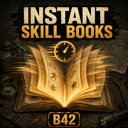

# Instant Skill Books for Project Zomboid B42

<p align="center">
  
</p>

Instant Skill Books v2.0.0 makes selected eligible learning items complete in one timed-action tick while preserving Project Zomboid's native server-authoritative validation, page completion, synchronization, and XP multipliers.

## Instant Learning settings

The server/world sandbox page **Instant Learning** has four independent settings. The server applies these settings authoritatively to every player in the world.

- `InstantSkillBooks` — default: `true`. Eligible skill books finish instantly.
- `InstantRecipeMagazines` — default: `false`. Eligible recipe magazines finish instantly when enabled.
- `InstantTechnicalManuals` — default: `false`. Visible for future compatibility, but currently inactive.
- `InstantEducationalVHS` — default: `false`. Visible for future compatibility, but currently inactive.

Technical manuals and educational VHS therefore retain vanilla behavior even when their visible settings are enabled. Maps, newspapers, ordinary literature, books outside the useful skill range, and Illiterate characters also retain vanilla behavior.

## Steam Workshop

[Subscribe to Instant Skill Books](https://steamcommunity.com/sharedfiles/filedetails/?id=3786090811)

- Workshop ID: `3786090811`
- Mod ID: `InstantSkillBooks`
- Target: Project Zomboid Build 42.20+

Dedicated-server configuration:

```ini
WorkshopItems=3786090811
Mods=InstantSkillBooks
```

Install the same Workshop version on the server and every client because the shared timed-action Lua participates in checksum validation.

## Development

The distributable mod is in [`InstantSkillBooks/`](InstantSkillBooks/). The behavior tests use Node.js and Fengari:

```powershell
cd work/instant-skill-books-tests
pnpm install --frozen-lockfile
node --test
```

Live multiplayer acceptance still needs to be performed against the target Project Zomboid server build.

## License

MIT — see [`LICENSE`](LICENSE).
