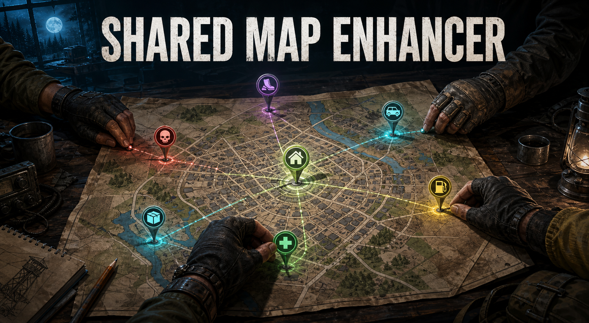

# Project Zomboid B42 Mods

This repository is a multi-mod Project Zomboid Build 42 workspace. Each mod has its own identity, source, tests, documentation, and release package.

## Available mods

<p align="center">
  
  
  
</p>

| Mod | Version | Guide | Status |
| --- | --- | --- | --- |
| [Instant Skill Books](mods/InstantSkillBooks/README.md) | 2.0.0 | [Install and configuration](mods/InstantSkillBooks/README.md) | [Published on Steam Workshop](https://steamcommunity.com/sharedfiles/filedetails/?id=3786090811) (`3786090811`) |
| [Smart Storage](mods/SmartStorage/README.md) | 0.1.0 | [Install and configuration](mods/SmartStorage/README.md) | Local B42 release package; Workshop upload and two-client acceptance remain follow-ups |
| [Shared Map Enhancer](mods/SharedMapEnhancer/README.md) | 0.1.0 | [Install and configuration](mods/SharedMapEnhancer/README.md) | Shared Map Enhancer local B42 release package; no Workshop ID |

## Instant Skill Books v2.0.0

[Instant Skill Books](mods/InstantSkillBooks/README.md) completes selected eligible learning items in one timed-action tick while preserving Project Zomboid's native server-authoritative validation, page completion, synchronization, and XP multipliers. Its source is in [`mods/InstantSkillBooks/`](mods/InstantSkillBooks/).

The server/world **Instant Learning** sandbox page provides four independent, server-authoritative settings:

- `InstantSkillBooks` — default: `true`.
- `InstantRecipeMagazines` — default: `false`.
- `InstantTechnicalManuals` — default: `false`; visible but currently inactive.
- `InstantEducationalVHS` — default: `false`; visible but currently inactive.

Technical manuals and educational VHS retain vanilla behavior even when their visible settings are enabled. Maps, newspapers, ordinary literature, books outside the useful skill range, and Illiterate characters also retain vanilla behavior.

Steam Workshop item: [Instant Skill Books [B42]](https://steamcommunity.com/sharedfiles/filedetails/?id=3786090811). Server installation:

```ini
WorkshopItems=3786090811
Mods=InstantSkillBooks
```

Install the same Workshop version on the server and every client because the shared timed-action Lua participates in checksum validation. See the [Instant Skill Books guide](mods/InstantSkillBooks/README.md) for local installation, compatibility, and acceptance checks.

## Smart Storage B42 v0.1.0

[Smart Storage](mods/SmartStorage/README.md) is an independent, server-authoritative nearby-storage organizer. It adds **Deposit compatible items** to the inventory context menu (English and Brazilian Portuguese translations) and moves only eligible player-owned items into compatible nearby containers after server-side validation.

The local package is `outputs/SmartStorage-0.1.0.zip` and contains only `SmartStorage/42/...`. Smart Storage has no Workshop manifest or Workshop ID: do not add it to `WorkshopItems=` until its owner creates a separate Workshop item.

Run its Fengari contract tests from [`work/smart-storage-tests/`](work/smart-storage-tests/):

```powershell
pnpm --dir work/smart-storage-tests test
```

## Shared Map Enhancer B42 v0.1.0

[Shared Map Enhancer](mods/SharedMapEnhancer/README.md) synchronizes categorized map markers for small cooperative sessions. Clients send intent and display only server-confirmed snapshots and deltas; the server validates, persists and expires every marker.

The local package is `outputs/SharedMapEnhancer-0.1.0.zip` and is enabled with `Mods=SharedMapEnhancer`. It has no Workshop ID, so do not add it to `WorkshopItems=`.

## Development

Each mod has its own behavior tests under `work/`, using Node.js and Fengari:

```powershell
pnpm --dir work/instant-skill-books-tests test
pnpm --dir work/smart-storage-tests test
pnpm --dir work/shared-map-enhancer-tests test
```

| Folder | Contents |
| --- | --- |
| `mods/<ModId>/42/` | Mod source shipped in each release package |
| `work/<mod>-tests/` | Fengari contract tests for each mod |
| `docs/assets/` | README cover images |
| `assets/` | Instant Skill Books Workshop preview image (256 × 256), staged as `preview.png` |
| `docs/superpowers/` | Design specs and implementation plans |

The [Shared Map Enhancer guide](mods/SharedMapEnhancer/README.md) documents its local B42 package and live acceptance checklist. The [roadmap](docs/superpowers/specs/2026-08-23-coop-quality-of-life-roadmap.md) keeps Smart Storage Workshop upload and live two-client acceptance explicit while retaining the Shared Map Enhancer follow-up acceptance work.

## License

Released under the [MIT License](LICENSE).
